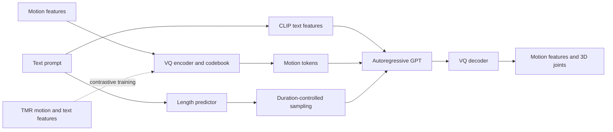

# AMG-T2M

**AMG: Long-Term Text-to-Motion Generation from Arbitrary-Length Prompts**

AMG-T2M is a text-to-motion research codebase built around a motion VQ-VAE, a text-conditioned autoregressive transformer, TMR-guided representation learning, and motion-length prediction. It includes training and evaluation entry points, feature preparation, generation tools, and latent-space analysis.

This repository contains the original local reproduction source under [`reproduction/local/`](reproduction/local/README.md), alongside maintained root-level training and resource-preparation tools. Motion datasets and experimental checkpoints are acquired separately through their official sources.

## Contents

- [Overview and examples](#overview-and-examples)
- [Repository layout](#repository-layout)
- [Installation](#installation)
- [Data and external resources](#data-and-external-resources)
- [Quick inference and preview](#quick-inference-and-preview)
- [Using the local reproduction source](#using-the-local-reproduction-source)
- [Maintained training workflow](#maintained-training-workflow)
- [Evaluation](#evaluation)
- [Length prediction and duration-controlled generation](#length-prediction-and-duration-controlled-generation)
- [Visualization and analysis](#visualization-and-analysis)
- [Troubleshooting and experiment records](#troubleshooting-and-experiment-records)
- [Documentation, provenance, and acknowledgments](#documentation-provenance-and-acknowledgments)

## Overview and examples

The motion tokenizer maps continuous motion features to discrete codes. The GPT model predicts motion codes from CLIP text features, and the VQ decoder reconstructs motion features and joint coordinates. TMR motion/text representations guide the contrastive VQ training branch. The separate length branch estimates duration from text features and dependency graphs.




*Illustrative text prompts and corresponding motion sequences.*


*Qualitative comparison of long-sequence motion generation.*


*Qualitative comparisons for long and short textual prompts. These figures are existing project assets; this repository update does not report newly measured results.*

## Repository layout

```text
AMG-T2M/
├── requirements.txt              # One shared, pinned Python dependency file
├── environment.yml               # Python/pip environment bootstrap
├── reproduction/
│   ├── local/                    # Original local project layout and experiment variants
│   │   ├── models/               # VQ/GPT, length models, TMR, and related modules
│   │   ├── dataset/              # Python loaders; motion data is not bundled
│   │   ├── utils/ and options/
│   │   ├── LibMTL/
│   │   ├── visualize/ and visualization/
│   │   └── train_*.py            # Local training entry points
│   ├── configure_paths.py        # Configure known local resource-path strings
│   └── source-manifest.json      # Source provenance and original hashes
├── src/                          # Organized model, dataset, loss, and utility modules
├── preprocess/                   # TMR pair preparation, VQ freezing, length features
├── tools/                        # Maintained training, evaluation, and generation commands
├── visualize/                    # Latent-space analysis and visualization source
├── resources/                    # External resource catalog
├── assets/                       # README figures
└── docs/                         # Environment, workflow, data, and source audit
```

Choose the working directory that belongs to the entry point:

| Workflow | Working directory | Example |
|---|---|---|
| Maintained training and generation | Repository root | `python tools/train_gpt.py ...` |
| Original local experiment variants | `reproduction/local/` | `python train_t2m_trans.py ...` |
| Original TMR commands | `reproduction/local/models/Retrival/` | Follow that directory's README |

The original and organized source trees have different import and resource conventions. Keep each command with its own loaders, configuration, and working directory. The maintained commands below run from the repository root unless explicitly stated otherwise.

## Installation

### Supported training environment

Use **Python 3.10 on Linux x86_64** with an NVIDIA GPU for the CUDA training workflows. The shared dependencies target **PyTorch 2.0.1 / CUDA 11.7**. The Conda bootstrap records Python 3.10.18. GPU memory requirements depend on the selected batch size, sequence length, and training variant.

Git is required for the pinned CLIP dependency. The Linux launchers use Bash, `flock`, `sha256sum`, and GNU `cp --parents`.

```bash
git clone https://github.com/SPOKEN-CX/AMG-T2M.git
cd AMG-T2M

conda env create -f environment.yml
conda activate AMG-T2M
python -m pip install -r requirements.txt
python -m pip check
```

There is **one active requirements file**. It includes VQ/GPT training, TMR/transformers, graph-based length prediction, the English spaCy model, evaluation, latent-space analysis, and Python rendering dependencies. No separate TMR, length, local-demo, or visualization installation is required.

The dependency file also pins resolved transitive versions. Historical dependency lists are retained as provenance in [`docs/dependency-history.json`](docs/dependency-history.json), rather than as additional installable requirements files. See the [environment guide](docs/environment.md) for the selected versions, native rendering prerequisites, and validation scope.

Check the active interpreter and required models:

```bash
python - <<'PY'
import torch, clip, transformers, spacy, torch_geometric
print('PyTorch:', torch.__version__)
print('CUDA runtime:', torch.version.cuda)
print('GPU available:', torch.cuda.is_available())
print('spaCy pipeline:', spacy.load('en_core_web_sm').pipe_names)
PY
```

## Data and external resources

The repository distributes source code and download references. **Datasets, captions, splits, annotation files, derived embeddings, normalization tensors, GloVe data, model weights, SMPL assets, and generated motions are not bundled.**

### Official acquisition links

| Resource | Official source | Usage |
|---|---|---|
| HumanML3D | [Data acquisition instructions](https://github.com/EricGuo5513/HumanML3D#how-to-obtain-the-data) | Main text-to-motion dataset |
| AMASS | [Official site](https://amass.is.tue.mpg.de/) and [license](https://amass.is.tue.mpg.de/license.html) | Source motion data used in HumanML3D preparation |
| KIT-ML | [Official dataset page](https://motion-annotation.humanoids.kit.edu/dataset/) | Optional dataset branch |
| BABEL | [Official site](https://babel.is.tue.mpg.de/) | Optional BABEL/TEACH-related local experiments |
| T2M-GPT resources | [Upstream repository](https://github.com/Mael-zys/T2M-GPT) | Baseline checkpoints and resource instructions |
| Text-to-motion evaluator | [Official repository](https://github.com/EricGuo5513/text-to-motion) | Matching evaluation assets and word-vector resources |
| TMR | [Official repository](https://github.com/Mathux/TMR) | Retrieval models, statistics, and annotation preparation |
| CLIP | [Official repository](https://github.com/openai/CLIP) | ViT-B/32 model used for text conditioning |

Follow each source's acquisition process and applicable terms. The upstream data instructions are authoritative; the historical local download scripts are not a fresh data installer.

### Expected maintained-workflow layout

```text
dataset/HumanML3D/
  new_joint_vecs/<motion_id>.npy    # Raw HumanML3D feature arrays: (T, 263)
  texts/<motion_id>.txt            # Corresponding official text annotations
  train.txt
  val.txt
  test.txt
checkpoints/t2m/
  Comp_v6_KLD005/opt.txt
  text_mot_match/model/finest_1.tar
  VQVAEV3_CB1024_CMT_H1024_NRES3/meta/
    mean.npy
    std.npy
glove/
  our_vab_data.npy
  our_vab_words.pkl
  our_vab_idx.pkl
ViT-B-32.pt
```

HumanML3D uses 22 joints, 263-dimensional motion features, and 20 FPS in the documented workflow. A generated `(T,22,3)` skeleton is a visualization output, not a replacement for raw training features. KIT uses a different representation and its own statistics/checkpoints.

TMR encoding additionally needs matching model weights, statistics, annotation indexes, and precomputed or regenerated text features. Consult the [resource catalog](resources/manifest.json), [data/model paths](docs/data-and-models.md), and [dataset notes](docs/datasets.md). The source manifest contains no motion data.

Keep normalization statistics, the evaluator, VQ codebook, token cache, and GPT checkpoint mutually compatible. Private experiment weights have no fabricated public download URL; obtain or train the matching models before inference.

## Quick inference and preview

The maintained local utility supports skeleton preview, VQ reconstruction, a short training-path check, and text-conditioned generation.

### Preview existing joints

```bash
python tools/run_local.py preview \
  --source /absolute/path/to/joints.npy \
  --out output/demo/preview_run
```

The input must contain `(T,22,3)` or `(1,T,22,3)` joint coordinates. This mode does not require VQ/GPT weights or the full dataset. It produces a GIF and a JSON report.

### Reconstruct an existing feature sequence

```bash
python tools/run_local.py reconstruct \
  --source /absolute/path/to/raw_motion_features.npy \
  --vq /absolute/path/to/vq_checkpoint.pth \
  --meta-dir checkpoints/t2m/VQVAEV3_CB1024_CMT_H1024_NRES3/meta \
  --device auto \
  --out output/demo/reconstruction_run
```

The source is a raw `(T,263)` feature sequence. The utility normalizes it with the supplied statistics, encodes and decodes it, and saves tokens, reconstructed features, joint coordinates, GIFs, and a report.

### Generate from text

```bash
python tools/run_local.py generate \
  --text "A person walks forward and turns left." \
  --vq /absolute/path/to/vq_checkpoint.pth \
  --gpt /absolute/path/to/matching_gpt_checkpoint.pth \
  --meta-dir checkpoints/t2m/VQVAEV3_CB1024_CMT_H1024_NRES3/meta \
  --clip-model ViT-B-32.pt \
  --device auto \
  --out output/demo/text_generation_run
```

Use a new output directory for each run. `--device auto` selects CUDA when available and CPU otherwise. `--sample` enables categorical token sampling; `--seed` controls the seed; `--no-gif` skips animation export. Repeating `--text` generates segments in order and concatenates their motion tokens. This utility does not apply a learned transition model between those segments.

For a small forward/backward check on local feature samples:

```bash
python tools/run_local.py train-smoke \
  --source /absolute/path/to/feature_sample_directory \
  --vq /absolute/path/to/vq_checkpoint.pth \
  --meta-dir checkpoints/t2m/VQVAEV3_CB1024_CMT_H1024_NRES3/meta \
  --steps 3 --device cuda --no-gif
```

This checks a training path and writes a smoke checkpoint; it is not a completed model training run or a benchmark evaluation.

## Using the local reproduction source

The original local source includes single/distributed VQ variants, local GPT/evaluation entry points, length models, TMR tools, LibMTL, and rendering code. Install the shared root environment once, then enter its source root:

```bash
cd reproduction/local
export PYTHONPATH="$PWD:$PWD/models/Retrival${PYTHONPATH:+:$PYTHONPATH}"

# Inspect known resource-path substitutions.
python ../configure_paths.py --data-root /absolute/path/to/Dataset
# Apply them to this source copy.
python ../configure_paths.py \
  --data-root /absolute/path/to/Dataset \
  --spacy-model en_core_web_sm --write
```

The data-root directory contains `HumanML3D/`, `KIT-ML/`, or `BABEL_TEACH/`. The configuration tool updates known path strings only; it does not download data or alter training computations. Resources such as `checkpoints/`, `pretrained/`, `glove/`, and `ViT-B-32.pt` must be available relative to this local source root for its original entry points.

Use the [local source README](reproduction/local/README.md) and the preserved [training/evaluation guide](reproduction/local/AMG_TRAIN_EVAL_GUIDE.zh-CN.md) for historical experiment variants. The latter remains in Chinese. The [current repository audit](docs/repository-audit.md) lists removed empty/duplicate entry points, scratch scripts, and tests, along with the purpose of retained optional tools. The initial source audit records historical missing file references.

## Maintained training workflow

The commands in this section run from the repository root, using the organized source tree and its recorded launch configurations.

### 1. Prepare TMR-aligned motion/text features

With HumanML3D and the matching TMR resources prepared, create the paired manifest and audit:

```bash
python preprocess/prepare_amg_tmr.py \
  --output output/amg_prepare/humanml3d_train_ready \
  --resolve-whitespace
```

Inspect `audit.json`. Resolve reported input errors before encoding. If `missing_precomputed_text` is nonzero, prepare the specified local DistilBERT model and recover those features:

```bash
python preprocess/prepare_amg_missing_text.py \
  --audit output/amg_prepare/humanml3d_train_ready/audit.json \
  --model-dir output/amg_prepare/models/distilbert-base-uncased \
  --output output/amg_prepare/missing_tokens
```

Then encode paired representations:

```bash
python preprocess/prepare_amg_tmr.py \
  --output output/amg_prepare/humanml3d_train_ready \
  --resolve-whitespace --encode --device cuda --batch-size 16
```

Add `--missing-token-dir output/amg_prepare/missing_tokens` to the encoding command only if the recovery step produced that directory. The resulting pair directory contains `train_pairs.jsonl`, motion/text embeddings, and an audit. Check that `errors` is empty and `missing_unresolved_text` is zero before VQ training.

### 2. Train and freeze the AMG VQ model

The recorded batch-512 protocol first trains to 10,000 steps, then resumes to a total of 100,000:

```bash
bash tools/run_amg_vq_b512_check10000.sh
bash tools/run_amg_vq_b512_100k.sh
```

Inspect each run's `console.log`, `status.txt`, and `result_summary.json`. Freeze the selected VQ checkpoint and its identity:

```bash
python preprocess/prepare_amg_gpt.py \
  --source-dir output/hml3d/VQ_amg_b512_k50_100k \
  --output output/hml3d/VQ_amg_b512_frozen
```

The resulting frozen VQ and `manifest.json` are inputs to the GPT workflow. A different VQ checkpoint requires a matching token cache and GPT model.

### 3. Train the text-conditioned GPT

Run the short check before the full protocol:

```bash
bash tools/run_amg_gpt_b512.sh check
bash tools/run_amg_gpt_b512.sh full
```

The `b512` in this launcher's filename identifies its VQ lineage, not every GPT batch size. The actual modes are:

| Mode | Microbatch | Accumulation | Effective batch | Training iterations |
|---|---:|---:|---:|---:|
| `check` | 32 | 1 | 32 | 100 |
| `full` | 128 | 1 | 128 | 100,000 |
| `extend300k` | 128 | 1 | 128 | 300,000 total, resumed from the full run |
| `gpt512300k` | 512 | 1 | 512 | 300,000 |
| `gpt4096check` | 512 | 8 | 4,096 | 2 |
| `gpt4096full` | 512 | 8 | 4,096 | 150,000 |

Inspect a launch command without starting training:

```bash
bash tools/run_amg_gpt_b512.sh full --dry-run
```

The larger modes are separate protocols. Their prerequisite checks, archive/resume conditions, VQ identity checks, and output locations are defined in the launcher. Choose the protocol that matches the experiment you intend to reproduce and record the actual batch/accumulation values.

## Evaluation

The recorded VQ test-evaluation launcher targets the documented 100k model:

```bash
bash tools/run_amg_vq_test_once.sh
```

For GPT evaluation, use the matching frozen VQ and GPT checkpoint. This example evaluates the `full` GPT protocol over 20 repeats:

```bash
python tools/eval_gpt.py \
  --dataname t2m \
  --num-layers 9 --embed-dim-gpt 1024 --n-head-gpt 16 \
  --block-size 51 --ff-rate 4 --drop-out-rate 0.1 \
  --nb-code 512 --down-t 2 --depth 3 --dilation-growth-rate 3 \
  --quantizer ema_reset --vq-act relu \
  --resume-pth output/hml3d/VQ_amg_b512_frozen/net_best_fid.pth \
  --resume-trans output/hml3d/GPT_amg_b512_full_bf16/net_best_fid.pth \
  --out-dir output/hml3d_eval --exp-name AMG_GPT_full --repeat-time 20
```

Evaluation uses the appropriate test split, fixed evaluator, GloVe, CLIP, normalization statistics, and checkpoint pair. Record the exact command, seed strategy, checkpoint hashes, and evaluator identity together with the reported metrics. Formal evaluation entry points are retained as project functionality; ad hoc test/probe scripts were excluded from the local-source archive.

## Length prediction and duration-controlled generation

The length branch can be trained independently of VQ/GPT. Its dependencies and `en_core_web_sm` are already included in the shared installation.

```bash
python preprocess/prepare_amg_lengths.py \
  --output output/amg_prepare/lengths_full_v2

bash tools/run_amg_lengths.sh
```

The launcher prepares frozen CLIP word features and dependency graphs, checks cached features, runs a 20-step batch-512 startup check, and trains the 50,000-step configuration. The best model is written to `output/hml3d/Length_amg_gat_b512_50k/net_best_mae.pth`. Inspect `status.txt`, `completion.json`, `test_metrics.json`, and the run logs.

Once matching VQ, GPT, and length models are available:

```bash
python tools/generate_amg_length_controlled.py \
  --gpt-checkpoint output/hml3d/GPT_amg_b512_full_bf16/net_best_fid.pth \
  --vq-checkpoint output/hml3d/VQ_amg_b512_frozen/net_best_fid.pth \
  --length-checkpoint output/hml3d/Length_amg_gat_b512_50k/net_best_mae.pth \
  --spacy-model en_core_web_sm \
  --text "A person walks forward, then sits down and stands up." \
  --out-dir output/demo/amg_duration_run
```

This entry point generates one duration-controlled segment per caption, with a maximum of 49 motion tokens / 196 frames at 20 FPS. Over-limit predictions raise an error unless explicit clipping is requested with `--allow-clip`. Preserve the GPT run's `vq_identity.json`; the entry point verifies that it matches the supplied VQ checkpoint.

## Visualization and analysis

- `tools/run_local.py preview` renders skeleton GIFs from local joint arrays without SMPL.
- `tools/demo.py` provides the maintained multi-step prompt demonstration using configured VQ/GPT resources.
- `visualize/latent_tsne_comparison/` contains feature extraction, checkpoint comparisons, selection protocols, and figure-generation tools. Start with its [analysis guide](visualize/latent_tsne_comparison/README.zh-CN.md) and configuration files.
- `reproduction/local/visualize/` and `render_final.py` preserve the original mesh-rendering source. These require external SMPL/SMPLify assets and a native OpenGL backend in addition to the Python packages. See [rendering prerequisites](docs/environment.md#native-rendering-and-optional-extensions).

Generated arrays, animations, figure outputs, and checkpoint files should remain in experiment output directories rather than being committed to the source repository.

## Troubleshooting and experiment records

| Symptom | What to check |
|---|---|
| CUDA is unavailable | The active interpreter, `torch.__version__`, `torch.version.cuda`, and host NVIDIA driver |
| Missing motion/text/normalization files | The working directory and the resource layout for the selected source tree |
| TMR encoding reports missing text features | The preparation audit, local tokenizer/model resources, and optional missing-feature recovery step |
| spaCy model cannot be loaded | The unified dependency installation and `spacy.load('en_core_web_sm')`; use `T2M_SPACY_MODEL` for a custom model path |
| VQ/GPT state-dict or identity mismatch | Architecture options, codebook dimensions, checkpoint lineage, statistics, and `vq_identity.json` |
| A launcher finds an existing run but cannot resume | Inspect its logs and full training checkpoint before reusing the experiment directory |
| Mesh rendering fails while skeleton preview works | SMPL/prior assets and the OSMesa/OpenGL system backend |

For each experiment, retain the source commit, actual command, dependency environment, dataset version/split, preprocessing audit, seed, normalization hashes, VQ/GPT pairing, evaluator identity, and output logs. Launcher names alone do not identify a complete protocol.

The dependency set has been resolved together for the documented Python/Linux target. Source syntax, path-configuration behavior, and publication contents were checked during maintenance. This update does not claim a fresh full-environment installation, GPU training run, or newly reproduced paper metrics.

## Documentation, provenance, and acknowledgments

- [Environment and unified installation](docs/environment.md)
- [Detailed workflow notes](docs/workflow.md)
- [Dataset formats and acquisition](docs/datasets.md)
- [External model/resource paths](docs/data-and-models.md)
- [Current privacy and repository-content audit](docs/repository-audit.md)
- [Initial local source audit](docs/local-source-sync.md)
- [Source manifest](reproduction/source-manifest.json)
- [FAQ](docs/FAQ.md)

The project builds on [T2M-GPT](https://github.com/Mael-zys/T2M-GPT), [TMR](https://github.com/Mathux/TMR), [HumanML3D](https://github.com/EricGuo5513/HumanML3D), and other attributed components. Cite the upstream methods and datasets relevant to your use. The AMG paper's public author/publication information and BibTeX will be added when available; no publication metadata is invented here.

See [THIRD_PARTY_NOTICES.md](THIRD_PARTY_NOTICES.md) and the retained license files. The root [LICENSE](LICENSE) does not replace the individual terms for third-party code, datasets, pretrained models, or body-model assets.
