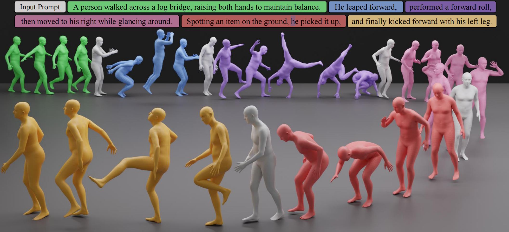
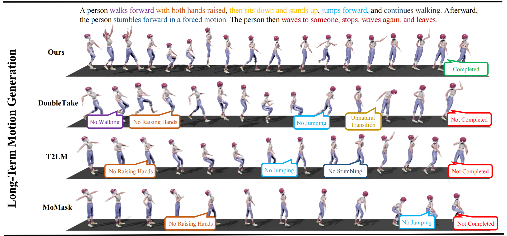
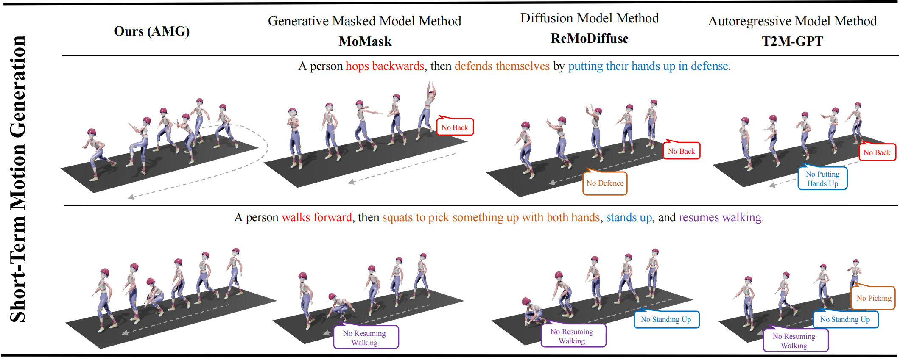

**AMG-T2M**

基于 T2M-GPT 的 HumanML3D 文本到动作研究工程，包含 TMR 语义对齐 VQ、配套 GPT、动作长度预测及潜空间分析代码。

## 效果预览



*文本提示与对应生成动作序列示例。*



*长时序动作生成结果对比。*



*AMG-T2M 与其他方法在长时序和短时序提示上的定性对比。*

论文标题：**AMG: Long-Term Text-to-Motion Generation from Arbitrary-Length Prompts**。目前处于投稿期，仓库保持 Private；论文尚未公开，引用信息先保留标题。

本仓库提供源码、依赖版本记录和使用说明。数据、模型权重、派生缓存及训练输出需单独准备。已包含组件和后续待补的完整流程见 [实现范围](docs/implementation-status.md)。

| 查阅内容 | 文档 |
|---|---|
| 实际依赖版本与安装顺序 | [环境与版本](docs/environment.md) |
| 数据集引用、获取与项目特有注意事项 | [数据集说明](docs/datasets.md) |
| 模型、资源目录和参考身份 | [数据与模型](docs/data-and-models.md)、[资源清单](resources/README.md) |
| VQ → 冻结 → GPT，以及长度模块与评估 | [脚本使用顺序](docs/workflow.md) |
| 代码来源和第三方授权范围 | [第三方说明](THIRD_PARTY_NOTICES.md) |
| 当前进度和后续公开事项 | [分阶段清单](docs/release-checklist.md) |

**仓库结构**

```text
LICENSE                 项目根许可证（第三方代码另见 THIRD_PARTY_NOTICES.md）
CITATION.cff            软件引用元数据；论文作者和 DOI 待正式公开后补充
README.md               项目入口
requirements.txt        精确主环境依赖入口
Dockerfile              Python 3.10.18 容器构建入口（尚未构建验收）
src/
  models/               VQ、GPT、长度估计器和 TMR 代码
  datasets/             数据集读取与配对数据集
  losses/               损失函数
  utils/                训练、评估和动作处理工具
  options/              现有命令行参数定义
configs/                实验配置说明；当前实验参数保存在 tools/run_*.sh
preprocess/             数据准备和特征生成
tools/                  训练、评估、demo、审计和运行脚本
visualize/              3D 绘图与潜空间分析
assets/                 README 图片资源
docs/                   环境、资源、流程和 FAQ
```

训练参数目前由版本控制中的启动脚本直接传入，不另建一份不会被训练程序读取的 YAML 副本；见 [configs 说明](configs/README.md)。从项目根目录运行 `python tools/...`，数据和模型仍按 [资源目录](resources/manifest.json) 单独放置。容器入口与挂载方式见下文和 [FAQ](docs/FAQ.md)。

**环境准备**

版本以现有工作环境的实际元数据为依据，完整记录见 [环境文档](docs/environment.md) 和 [机器可读版本表](docs/environment-versions.json)。

| 组件 | 记录版本 |
|---|---|
| Python | 3.10.18 |
| PyTorch / CUDA 构建 | 包版本 2.0.1；运行构建 2.0.1+cu117 |
| torchvision / torchaudio | 包版本 0.15.2 / 2.0.2；运行构建均为 +cu117 |
| NumPy / SciPy | 1.24.1 / 1.11.2 |
| CLIP | Git commit `d05afc436d78f1c48dc0dbf8e5980a9d471f35f6` |
| TMR 附加 transformers | 4.38.2 |
| 长度模块 torch-geometric / spaCy / 英文模型 | 2.5.3 / 3.5.4 / en_core_web_sm 3.5.0 |

主环境105个包、TMR附加4个包、长度模块附加50个包分别记录并保留原加载顺序。按当前安排，暂缓全新环境安装验收和demo验证。以下命令供后续重建环境使用：

```bash
# 在项目根目录执行；供后续重建环境时使用
conda env create -f environment.yml
conda activate AMG-T2M
python -m pip install -r requirements.txt
```

长度预测模块沿用原工程的独立附加依赖方式：

```bash
python -m pip install --no-deps --target .runtime/length_deps -r requirements-length.txt
python -m pip install --no-deps --target .runtime/length_models -r requirements-spacy-model.txt
```

TMR文本特征附加包见 `requirements-tmr.txt`，安装到独立目标目录并通过 `PYTHONPATH` 加载；潜空间分析所用版本已包含在主环境记录中。具体命令及加载顺序见 [环境文档](docs/environment.md)，不要把主环境和附加锁文件合并为一次pip安装。可通过 `T2M_PYTHON` 指定解释器，通过 `T2M_LENGTH_DEPS` 和 `T2M_SPACY_MODEL` 指定现有附加依赖和解析模型位置。

**使用入口**

| 任务 | 入口 | 前置条件 |
|---|---|---|
| 基础 VQ | `tools/train_vq.py` | HumanML3D、归一化统计、评估器和 GloVe |
| TMR 配对准备 | `preprocess/prepare_amg_tmr.py` | TMR、统计量和预计算文本特征 |
| AMG 对比 VQ | `tools/train_amg_vq.py` | 基础资源及 TMR 配对特征 |
| GPT | `tools/train_gpt.py` | 确定的冻结 VQ、配套 token、CLIP 和评估资源 |
| 长度预测 | `tools/train_length_est.py` | 长度记录、CLIP 词特征、依存图和可选依赖 |
| VQ/GPT 评估 | `tools/eval_vq.py`、`tools/eval_gpt.py` | 正确配套的权重和指定 split |
| 单段长度控制 | `tools/generate_amg_length_controlled.py` | 已核验的 VQ/GPT/长度权重及身份文件 |
| 潜空间分析 | `visualize/latent_tsne_comparison/run.sh` | 合法取得的数据、选定 checkpoint、分析依赖 |

完整脚本顺序、VQ batch512 的10000步到总计100000步续训、冻结VQ路径及GPT各模式的实际batch见 [使用流程](docs/workflow.md)。`tools/run_*.sh` 保留了实验参数与恢复检查，运行前确认资源和输出目录；其中部分入口会启动长时间训练。

环境准备后可单独运行以下逻辑检查：

```bash
python -m tools.test_gpt_accumulation
python -m tools.test_gpt_length_control
```

这两个检查覆盖相应代码逻辑。动作生成demo、训练和指标评估各有独立资源要求，本轮均未运行。已有结果以原实验记录为准；源码整理记录见 [快照改动及验证](docs/snapshot-changes.md)。

**来源和授权**

T2M-GPT 上游：[项目仓库](https://github.com/Mael-zys/T2M-GPT)、[论文](https://arxiv.org/abs/2301.06052)。TMR 上游：[项目仓库](https://github.com/Mathux/TMR)、[论文](https://arxiv.org/abs/2305.00976)。数据来源与相关代码：[HumanML3D](https://github.com/EricGuo5513/HumanML3D)。继承代码的精确来源版本及公开再分发范围仍需在正式发布前确认。

根目录 [LICENSE](LICENSE) 是工作区已有的 Apache-2.0 文本。第三方文件存在不同条款，特别是四元数工具所保留的 QuaterNet 非商业条款；本项目尚未完成统一公开授权审查，不能据根目录许可证推定所有文件、数据和权重均允许商用。必要权利声明见 [THIRD_PARTY_NOTICES.md](THIRD_PARTY_NOTICES.md)。

Issues 提供环境/错误报告与结果复现问题模板。请附上所用依赖配置、命令、种子、模型身份及脱敏错误信息。后续更新取决于研究进度和维护者时间；正式公开事项见 [分阶段清单](docs/release-checklist.md)。

**Docker（尚未构建验收）**

`Dockerfile` 使用 Python 3.10.18 并通过 `requirements.txt` 安装已记录的精确主环境依赖；本轮没有构建镜像或验证 GPU。构建前确保合法获取的数据、权重和外部资源不进入镜像上下文，`.dockerignore` 已排除这些目录。

```bash
docker build -t amg-t2m .
docker run --rm --gpus all -v "$PWD/dataset:/workspace/dataset:ro" \
  -v "$PWD/checkpoints:/workspace/checkpoints:ro" amg-t2m tools/train_vq.py --help
```

容器需要 NVIDIA Container Toolkit 才能访问宿主机 GPU；示例只说明调用和只读挂载方式，路径及权重参数需按资源文档调整。
